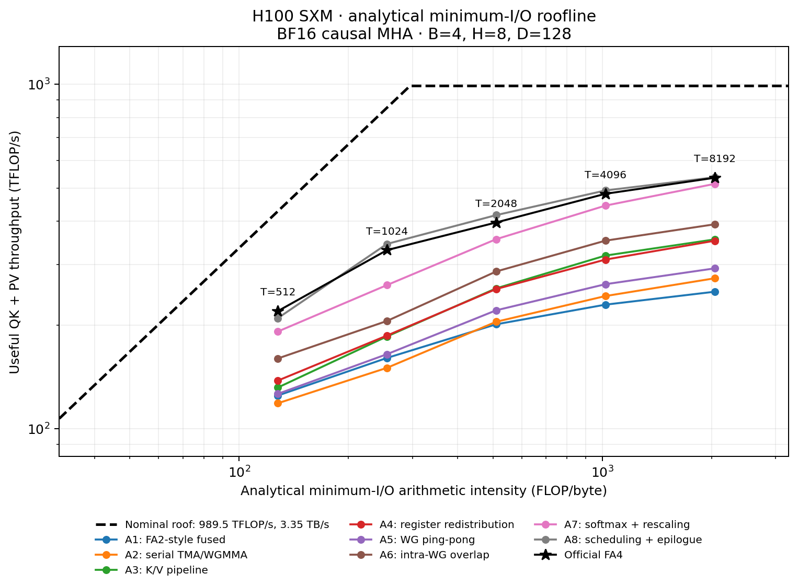

# fa-h100

## Run

```bash
uv sync --locked
uv pip install --python .venv/bin/python flash-attn-4==4.0.0b34

GPU_KERNELS_CUDA_ARCH=90 bash scripts/test.sh flash_attention
GPU_KERNELS_CUDA_ARCH=90 bash scripts/benchmark.sh flash_attention h100 --reference fa4 --trials 35
bash scripts/benchmark_attention_ablation.sh
```

## Benchmark

H100 SXM · BF16 causal MHA · `B=4, Hq=Hkv=8, D=128` · CUDA Graph median, 35 trials · 2026-10-16.

| T | Custom µs | FlashAttention-4 µs | Reference % |
| ---: | ---: | ---: | ---: |
| 2048 | 78.23 | 77.54 | 99.1 |
| 4096 | 265.06 | 263.87 | 99.5 |
| 8192 | 975.55 | 971.83 | 99.6 |
| 16384 | 3717.90 | 3690.64 | 99.3 |

`Reference % = FA4 time / custom time × 100`.

## Ablation

Saved A1–A8 run · H100 SXM · BF16 causal MHA · `B=4, H=8, D=128, T=8192` · FA4: 1026.91 µs. A8 predates the production L2 promotion update.

| Stage | Cumulative implementation | Time µs | Reference % |
| :--- | :--- | ---: | ---: |
| A1 | FA2-style fused | 2200.30 | 46.7 |
| A2 | Serial TMA/WGMMA | 2011.30 | 51.1 |
| A3 | K/V pipeline | 1550.62 | 66.2 |
| A4 | Register redistribution | 1564.65 | 65.6 |
| A5 | WG ping-pong | 1882.31 | 54.6 |
| A6 | Intra-WG overlap | 1401.71 | 73.3 |
| A7 | Softmax + rescaling | 1069.69 | 96.0 |
| A8 | Scheduling + epilogue | 1023.54 | 100.3 |

Saved figures: `T ∈ {512,1024,2048,4096,8192}`. Current runner: `T ∈ {2048,4096,8192,16384}`.



